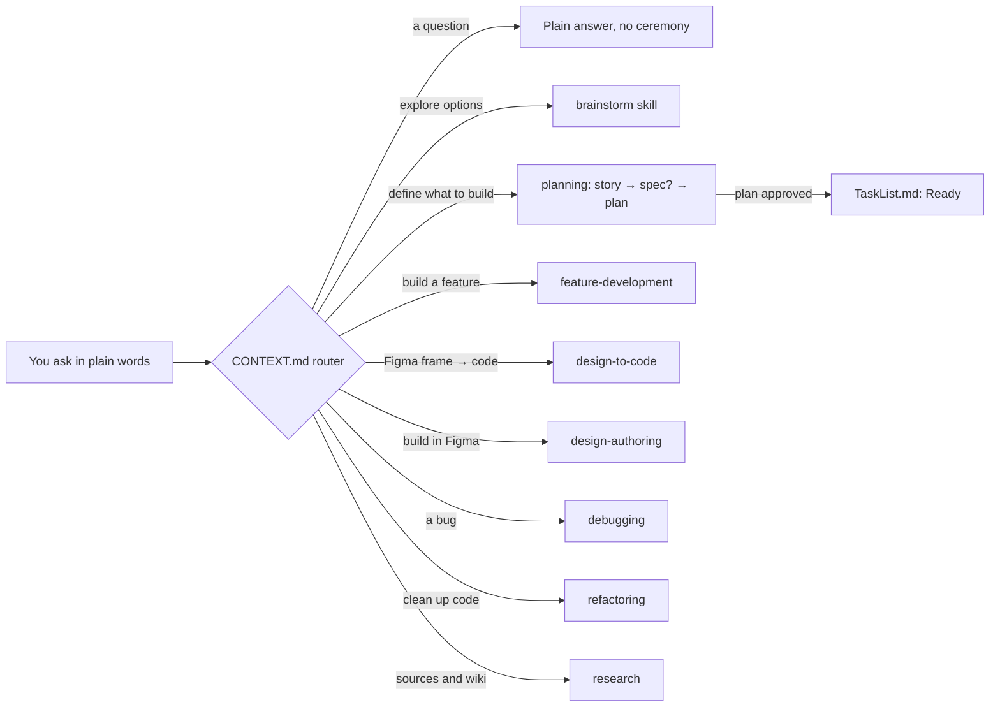
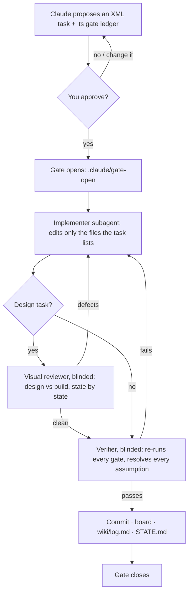

# Glacier Flow — A General-Purpose Template for Claude Code


A general-purpose template for Claude Code, built to keep AI-assisted product work — code *and* Figma — predictable, cheap and provable. Six patterns work together:

- **Folder-based routing** (ICM, Van Clief) — you talk normally; a small routing file loads only the one workspace your request needs, so a session pays for its task and nothing else
- **Markdown knowledge base** (LLM Wiki, Karpathy) — *what* the AI knows, compiled from immutable sources
- **XML task gates** — nothing changes until you approve a written task; a hook blocks writes that skip it
- **Spec-driven planning** (story → spec → plan → build) — *how intent survives contact with implementation*
- **Evidence ledgers** — "done" means checks that ran and recorded proof, plus manual sign-off for what only a person can see (hover, empty, error states)
- **Role-based, blinded agents** — an implementer builds; a visual reviewer and a verifier check it without ever seeing the builder's reasoning

Design work is first-class in both directions: Figma → code (`design-to-code`) and building inside Figma (`design-authoring`).

## Lineage

This template started as a fork of [dragon-ice-flow](https://github.com/niellune/dragon-ice-flow), then diverged in seven ways:

1. **Architecture is pluggable, not hardcoded.** The original bakes in Feature-Sliced Design as a non-negotiable rule. This version ships `reference/architecture/` empty — you (or Claude, with your approval) document whatever pattern fits *this* project the first time it matters, or skip it entirely for non-frontend work. FSD is available as an inert preset in `reference/architecture/_presets/` for the projects where it does fit.
2. **A `design-to-code` workspace was added.** Built for going from a Figma frame (or a screenshot, or "make it look like X") to working code — visual QA against the design, design tokens as the source of truth for values, and a Definition of Done that covers states (hover/empty/error/loading), not just the happy path. Visual QA is done by a separate, blinded visual reviewer — never the agent that built the screen — and recurring mistakes collect in a known-failure-patterns table. A design-system skeleton (`reference/_presets/design-system.md`) maps Figma variables to code names and tracks which states are built and signed off.
3. **The write-gate hook is cross-platform.** `.claude/hooks/gate-check.mjs` runs on Node, so the gate fires identically on macOS, Linux, and Windows. The original ships PowerShell-only.
4. **Delegation is role-based and cost-gated.** `.context/subagent-delegation.md` routes approved work by role (implementer / visual reviewer / verifier / housekeeper) rather than by model name, blinds each reviewing role to the builder's reasoning, and requires explicit approval before escalating to an expensive tier. The original hardcodes a fixed model lineup.
5. **A `design-authoring` workspace was added** — the reverse of `design-to-code`: agent-scripted authoring *in* Figma (screens, components, variables) via the Plugin API. It treats the Figma file as a gated production surface, encodes the Plugin API rules that fail silently when ignored (font loading, auto-layout property order, staged builds), verifies mutations with property reads instead of screenshots, and keeps a growing known-failure-patterns table. The tool-convention approach is distilled from [figmosha2](https://github.com/denysosadchyi/figmosha2)'s conventions plus accumulated project experience.
6. **A contradiction guard was added.** A request that contradicts a decision already written in `reference/` or `.context/` gets surfaced, not silently applied or silently dropped (`.context/rules.md`, non-negotiable 6). It reuses `wiki/log.md`'s existing, already-windowed `decision` entries rather than adding a new always-growing file.

7. **Verification is a ledger of evidence, not a claim.** A task's `<verify>` becomes a gate ledger (`gates/<task-id>.md`) once it has two or more gates or any manual gate. Each gate is a `CHECK` command, an `EXPECT` regex and an `EVIDENCE` line written only by the runner — and the evidence carries a digest of the CHECK+EXPECT it ran against, so editing either half of a met gate flips it to unmet. You cannot move the goalposts and keep the evidence. A linter refuses gates that *cannot fail*: bare-success expectations, pinned test counts, activity titles, tautological checks, hand-ticked boxes. Manual gates — the hover state, the empty state, anything only a person can see — stay **owed** until the owner signs them. Upstream's equivalent is PowerShell; this one is Node, for the same reason as #3.

Upstream is tracked by hand — the two repos share no git history, so improvements are ported file-by-file rather than merged. Last read through dragon-ice-flow `771492b` (2026-09-22).

Deliberately not taken: the ten-file multi-agent pipeline with its round files, dossiers and stage-cost tables (that is process for a team pushing many features through one working tree), and the `unslop` prose scanner as a blocking hook (its preservation contract is worth stealing; a regex gate tuned to someone else's house voice is not). Both remain upstream if this template ever grows into them.

The spec-driven development phasing (What → How → Task → Build) described in [intent-driven.dev's vibe-coding-vs-spec-driven-development](https://intent-driven.dev/blog/2025/12/15/vibe-coding-vs-spec-driven-development/) is already the shape of the `planning/` workspace here — story (what) → spec (how) → plan (task breakdown) → `feature-development`/`design-to-code` (build). Its core warning — *"specs and plans are not the goal, they are scaffolding"* — is enforced structurally: lightweight-story-by-default, full spec only when complexity earns it.

## Core Idea

Most templates make you learn commands. This one doesn't.

**Default: plain conversation.** You ask questions. Claude answers like a thoughtful colleague — short sentences, no XML, minimal ceremony. The workspace that fits your request gets loaded silently in the background.

**Structure fires on intent.** When you ask Claude to actually change something — "add a button", "fix this bug", "create the spec" — the XML task wrapper appears. The gate is real, and mechanically enforced by a hook (not just a convention Claude might forget). You approve, Claude executes. Otherwise, structure stays out of the way.

**Depth is opt-in.** Want more? Say "tell me more", "why", "explain", "details". Without those signals, Claude gives you the short answer.

## Folder Map

```
your-project/
│
├── CLAUDE.md              ← always loaded
├── CONTEXT.md             ← routing table
├── STATE.md               ← current state (now)
├── TaskList.md            ← active kanban board
├── SETUP.md               ← one-time setup; canonical
├── .gitattributes         ← LF pinned
│
├── .claude/
│   ├── settings.json      ← registers both hooks
│   ├── hooks/             ← gate-check.mjs (the XML gate), budget-check.mjs (always-load budgets)
│   └── scripts/           ← gates.mjs (ledger runner + linter), tests/ (71 tests, zero dependencies)
│
├── .context/
│   ├── identity.md
│   ├── rules.md
│   ├── glossary.md
│   ├── task-workflow.md   ← code gate
│   ├── task-workflow-appendix.md
│   ├── gates-ledger.md    ← verification ledger: format, threshold, linter rules
│   ├── subagent-delegation.md  ← role routing + cost gate
│   └── housekeeping.md
│
├── workspaces/            ← feature-development, design-to-code, design-authoring, debugging, refactoring, planning, research
├── skills/                ← brainstorm (and future skills)
├── planning/              ← stories, specs, plans (each with index.md)
├── gates/                 ← one verification ledger per task in flight; deleted at close
├── reference/             ← deep docs YOU wrote, incl. architecture/ (empty until you decide); _presets/ holds inert starters
│
├── raw/                   ← immutable sources
├── wiki/                  ← LLM-maintained knowledge (index, log, entities, concepts, sources)
│
└── src/                   ← your actual code
```

## How It Works

### 1. Every request is routed to one workspace

A few small files are always loaded (`CLAUDE.md`, `STATE.md`, the rules' non-negotiables, the gate rules). Everything else loads only when the router picks it.



### 2. Every change goes through the gate and is checked by someone else



- **Two implement attempts, then it stops and asks you.** A third round means the task is wrong, not the code.
- **Manual gates** (the hover state, the empty state) stay *owed* until you sign them.
- **Spend is gated too:** a pricier model or a wide fan-out of agents needs your yes first.
- **Hooks enforce it:** `gate-check.mjs` blocks gated writes without the open gate; `budget-check.mjs` keeps the always-loaded root files small.

## First-Time Bootstrap (15–30 min)

Full walkthrough in **[SETUP.md](SETUP.md)** — getting the template, verifying the gate actually
blocks, filling identity/state/rules, and a first-session smoke test. Don't skip the gate check: the
hook fails open by design, so a broken one is invisible.

## Day-to-Day Usage

Just describe what you need. Claude will pick the workspace silently. Examples:

| You say | What happens |
|---|---|
| "I want to add export to dashboards" | feature-development workspace, XML task proposed |
| "Implement this Figma frame" (link or screenshot) | design-to-code workspace, every state checked by a blinded visual reviewer |
| "Build this component set in Figma" | design-authoring workspace, gated Figma mutations, verified by property reads |
| "There's a weird bug with login" | debugging workspace, diagnostic questions |
| "Let's think through options for caching" | brainstorm skill, divergent mode |
| "Let me write a story for export" | planning workspace, story format |
| "Ingest the file at raw/karpathy-llm-wiki.md" | research workspace, ingest gate |
| "What does the wiki say about caching?" | research workspace, query mode |

The structure is there when you need it; otherwise it's out of the way.

## Production Housekeeping

Real projects accumulate files. Without rules, the always-load budget grows and the wiki becomes noise. Run a housekeep pass periodically:

- **Weekly:** trim `STATE.md` + completed-task windows (5 min)
- **Monthly:** full housekeep — wiki lint, planning archive review, reference cleanup
- **Quarterly:** archive done planning artifacts to `planning/_archive/[year-quarter]/`

The full ruleset lives in `.context/housekeeping.md`. It's a *proposal* workflow — Claude lists what should be trimmed; you approve before anything moves.

The always-load budgets are enforced rather than merely documented: `.claude/hooks/budget-check.mjs` refuses a write that pushes the root `CLAUDE.md`, `CONTEXT.md`, `STATE.md` or `TaskList.md` past its byte limit (a workspace's own `CONTEXT.md` is not budgeted), and reports on all four during a housekeep. Byte limits rather than token targets, because bytes are measurable in the repo and an unenforceable budget is a wish.

## Core Principles

### Structure
1. **One-Place Rule.** Every fact lives in exactly one file.
2. **One-Way References.** A → B only, never bidirectional.
3. **Selective Section Loading.** Load the named section, not whole files.
4. **Routing is not work.** `CONTEXT.md` directs traffic; it doesn't contain answers.

### Knowledge
5. **`raw/` is immutable.** Source of truth; never modified.
6. **Compile once, query forever.** Don't re-read raw sources every time.
7. **Good answers compound.** File comparisons and analyses back as wiki pages.
8. **The LLM does maintenance.** Humans curate sources; Claude handles bookkeeping.

### Discipline
9. **The gate.** No writes to a gated surface without approval — `src/`, `reference/`, `.context/`, `.claude/`, `CLAUDE.md` and `CONTEXT.md` need an XML task; `planning/` and `wiki/` have their own gates; task bookkeeping (`STATE.md`, `TaskList.md`, `wiki/log.md`) is exempt. `.claude/` is on that list because the hooks and the ledger runner *are* the enforcement, and a gate that cannot protect its own implementation is a convention rather than a gate. Canonical table: `.context/task-workflow.md`. Reads are free. Enforced mechanically by `.claude/hooks/gate-check.mjs`, which has its own test suite.
10. **State vs Log.** `STATE.md` = now (overwrite). `wiki/log.md` = past (append). `TaskList.md` = in-flight.
11. **One task, one commit.** No opportunistic refactoring; no combined tasks.
12. **Architecture is earned, not assumed.** Don't decide `src/` structure until a real file needs a home; then write it down once in `reference/architecture/` and don't re-litigate it.
13. **Verification is evidence, not a claim.** A gate records what ran, when, and against which command — and editing the question invalidates the answer. Format, threshold and linter rules: `.context/gates-ledger.md`.

## Anti-Patterns

- ❌ Editing files in `raw/`
- ❌ Letting `wiki/index.md` grow stale
- ❌ Treating `wiki/` as authoritative for project decisions
- ❌ Loading the whole wiki instead of starting at `index.md`
- ❌ Dumping all docs into one `CLAUDE.md`
- ❌ Bidirectional references between docs
- ❌ Letting `STATE.md` accumulate resolved decisions and fixed bugs
- ❌ Using `reference/` as a dumping ground for general knowledge (that's `wiki/concepts/`)
- ❌ Skipping housekeeping because nothing feels broken (it never feels broken until it does)
- ❌ Guessing an architecture pattern and hardcoding it before the project needs one
- ❌ Writing a gate that cannot fail — `EXPECT: ok`, a pinned test count, or a title naming an activity instead of a property that holds

## Works At Any Stage

- **Planning:** Folders as thinking tools. Optional: ingest 2–3 foundational sources.
- **Early prototype:** Minimal fill-in. Skip wiki.
- **MVP:** Full workspaces. Wiki grows as you research adjacent topics.
- **Production:** Both fully active. Wiki becomes the team's compounding memory.

## What's Changed

Release-level summary. The task-by-task record, with each gate's evidence, lives in `wiki/log.md`; the work in flight is on `TaskList.md`.

- **2026-10-15 — plan revised from GitHub research.** Ideas from figma/mcp-server-guide, Figma-Context-MCP, figwright, superpowers, spec-kit and BMAD were checked against this template's constraints (Node only, zero dependencies, blinding, cost gate) and folded into `planning/plans/design-flow-hardening.md` as feat-013…020. This README gained the workflow diagrams above.
- **2026-10-14 — design-flow-hardening, part A** ([#5](https://github.com/nimfardo/glacier-flow/pull/5)). Visual QA moved to a blinded visual reviewer; a design-system preset maps Figma variables to code names and tracks which states are built and signed; design-to-code got a known-failure-patterns table; the budget hook now applies only to the root files (a workspace `CONTEXT.md` no longer raises a false alarm).
- **2026-09-23 — verification becomes evidence** ([#3](https://github.com/nimfardo/glacier-flow/pull/3), [#4](https://github.com/nimfardo/glacier-flow/pull/4)). Gate ledgers with CHECK / EXPECT / EVIDENCE and a linter that refuses gates that cannot fail; tests for the gate hook; the byte-budget hook; `SETUP.md`; LF line endings pinned.
- **2026-08-28 — guards and design discipline** ([#2](https://github.com/nimfardo/glacier-flow/pull/2)). Contradiction guard; tool availability record and bulk-rollout discipline in design-to-code; quarterly doc-fitness check; branch + pull request rule for pushes.
- **2026-08-15 — synced from dragon-ice-flow** ([#1](https://github.com/nimfardo/glacier-flow/pull/1)). Role-based delegation with a cost gate, the cross-platform Node gate hook, and Feature-Sliced Design as an inert preset.

**Next:** feat-013…020 (reading Figma cheaply, session handoff, file-based agent briefs, a Figma build ledger with confirmed rollback, mapping confidence, a states checklist in planning), then feat-015 — one real Figma → code run.

## Further Reading

- Karpathy's LLM Wiki gist: gist.github.com/karpathy/442a6bf555914893e9891c11519de94f
- ICM paper: arXiv 2603.16021 (Van Clief & McDermott)
- Reference ICM repo: github.com/RinDig/Content-Agent-Routing-Promptbase
- Spec-driven development vs vibe coding: intent-driven.dev/blog/2025/12/15/vibe-coding-vs-spec-driven-development
- Original template this forked from: github.com/niellune/dragon-ice-flow

## License

MIT — see [LICENSE](LICENSE).
